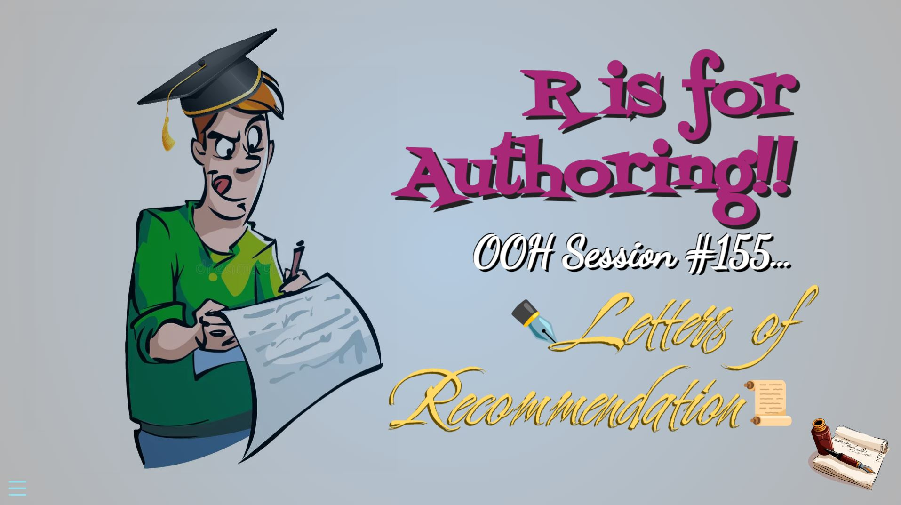

## Open Office Hours <br>(`r format(Sys.Date(),"%B %d, %Y")`) 

::: {.columns}
::: {.column width="55%"}
+ Recap session #155
+ Today's topic(s):
    + [[Admonitions!!]{.kavoon .bigger}](https://github.com/nessan/admonitions)
+ Shared problem-solving

:::

::: {.column width="45%"}

<br>
<br>
<br>
<br>
<br>

::: {.callout-note}
## Reminder -- check it out!! 
Fantastic [ resource!! ](https://qmd4sci.njtierney.com/) 
:::

:::

:::

::: {.absolute style="top: 170px; right: -120px; width:550px;"}
<a href="https://jtkulas.github.io/LiveStreams/slides/2026/11_10_26">
  
</a>
:::

{.absolute top="165" left="385" width="200"}

# Recap of Session <br>#155: 

{.absolute right="100"}

{.absolute top="290" right="120" height="180"}

## [[Letters of Recommendation]{.calligraphy .Bigger}](https://github.com/jtkulas/recletters-typst#letters-of-recommendation---quarto)

::: {.columns}

::: {.column width="52%"}

[\*.Rmd:]{.bigger .underline}

 multiple $\LaTeX$ commands  
 multiple $\LaTeX$ packages 
 ground--up construction for look & feel  
 produces .pdf 
  
:::

::: {.column width="48%"}

[\*.qmd:]{.bigger .underline}  

 requires > Quarto 1.10\
 dupes institutional letterhead\
 no construction\
 produces .pdf 

:::

:::

{.absolute right="-160" bottom="120" height="300"}

{.absolute left="330" bottom="-10" height="230"}

# Today...


## [[Admonitions!!]{.kavoon .bigger}](https://github.com/nessan/admonitions)

{.absolute height="550"}

{.absolute right="-150" bottom="120" height="250"}

{.absolute left="-150" bottom="70" height="170"}

{.absolute left="-160" top="120" height="250"}

{.absolute right="-130" top="-30" height="350"}

##  &  Session Info (`r format(Sys.Date(),"%B %d, %Y")`): 

::: {.columns}

::: {.column width="80%"}
```{r}
#| echo: false
#| eval: true
sessionInfo()
```
:::

::: {.column width="20%"}

Quarto version `r quarto::quarto_version()`  

:::

:::
