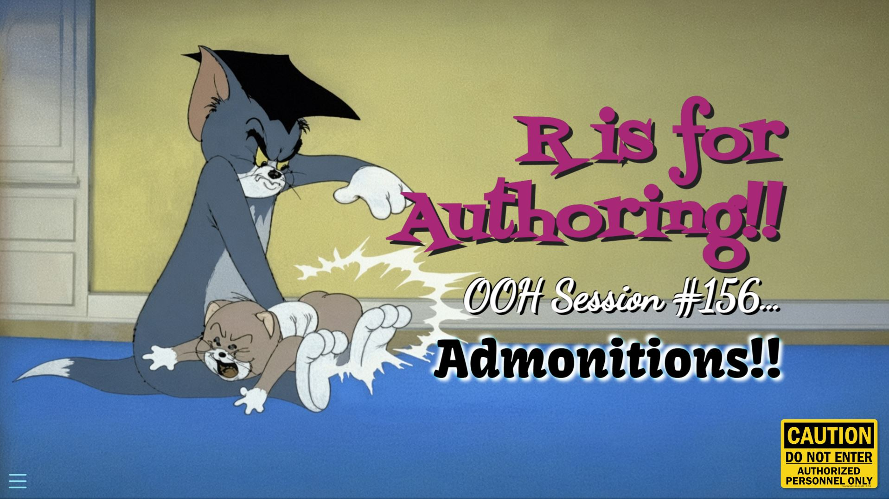
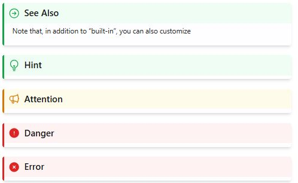
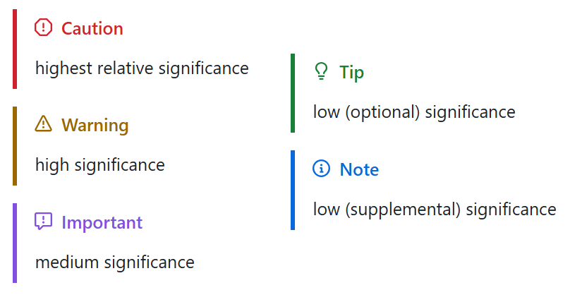
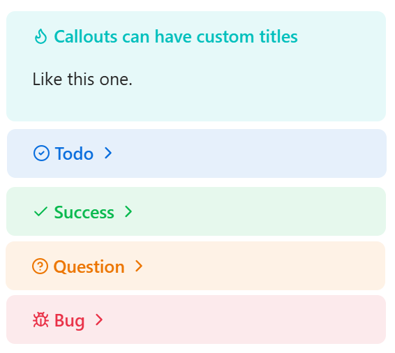

## Open Office Hours <br>(`r format(Sys.Date(),"%B %d, %Y")`) 

::: {.columns}
::: {.column width="55%"}
+ Recap session #156
+ Today's topic(s):
    + [[download]{.downloadthis .bigger}<br>&nbsp;&nbsp;[this!!]{.downloadthis .bigger}](https://github.com/shafayetShafee/downloadthis)
+ Shared problem-solving

:::

::: {.column width="45%"}

<br>
<br>
<br>
<br>
<br>

::: {.callout-note}
## Reminder -- check it out!! 
Fantastic [ resource!! ](https://qmd4sci.njtierney.com/) 
:::

:::

:::

::: {.absolute style="top: 170px; right: -120px; width:550px;"}
<a href="https://jtkulas.github.io/LiveStreams/slides/2026/11_17_26">
  
</a>
:::

{.absolute top="165" left="385" width="200"}

# Recap of Session <br>#156: 

{.absolute right="100"}

{.absolute top="295" right="125" height="185" .tiltpostit}

## [[Admonitions!!]{.kavoon .bigger}](https://www.linkedin.com/pulse/rules-admonitions-steve-arrants-wxwre/)

::: {.panel-tabset}

### +[[{]{style="color: #f37821;" .bigger}[MyST]{style="color: white;"}[}]{style="color: #f37821;" .bigger}]{.myst}

::: {.columns}

::: {.column width="50%"}

+ ten ["admonitions"](https://mystmd.org/guide/admonitions)
+ shared [ origin](https://www.sphinx-doc.org/en/master/) (w [](https://quarto.org/docs/authoring/callouts.html))  
+ dropdown capable (e.g., collapsable)
+ native support with:
```text
pip install jupyterlab_myst
``` 

:::

::: {.column width="50%"}
:::

:::

{.absolute right="-130" bottom="40" height="400"}

### 

::: {.columns}

::: {.column width="50%"}

+ five ["alerts"](https://docs.github.com/en/get-started/writing-on-github/getting-started-with-writing-and-formatting-on-github/basic-writing-and-formatting-syntax#alerts)
+ recommends adherence to significance hierarchy
+ specification indicated by "special blockquote":

```text
> [!NOTE]
> content goes here
```
:::

::: {.column width="50%"}
:::

:::

{.absolute right="-150" bottom="90" height="350"}

### 

::: {.columns}

::: {.column width="50%"}

+ thirteen ["callout" types](https://obsidian.md/help/callouts)  
+ solid background color
+ [nestable!! ](https://obsidian.md/help/callouts#Nested+callouts)  
+ spex similar to :  

```text
> [!faq]- How foldable?
> plus (+) or minus (-) directly 
> after the type identifier.
```

:::

::: {.column width="50%"}
:::

:::

{.absolute right="0" bottom="5" height="450"}

### Extension

::: {.columns}

::: {.column width="50%"}

+ five ["ASCII--styled" callouts](https://github.com/nessan/admonitions)  
+ transparent background
+ undifferentiated spex (from plain--text):

```text
TIP: This is a tip

```
:::

::: {.column width="50%" .wee}

TIP: Tip: Your waitress generously

CAUTION: Caution: Watch your step 

WARNING: Warning: Ooh scary stuff!!!

IMPORTANT: Important: Nothing else matters 

NOTE: Note: Take notes here 

:::

:::

:::

{.absolute right="-100" top="-50" height="250" .tilt}

# Today...


## [[download]{.downloadthis .bigger} [this!!]{.downloadthis .bigger}](https://github.com/shafayetShafee/downloadthis)

{.absolute right="-190" top="-20" height="150" .tilt}

{.absolute height="450" left="-180" top="70"}

{.absolute right="-130" bottom="100" height="400"}

{.absolute bottom="80" left="280" height="500"}

{.absolute left="-180" bottom="0" height="200"}

##  &  Session Info (`r format(Sys.Date(),"%B %d, %Y")`): 

::: {.columns}

::: {.column width="80%"}
```{r}
#| echo: false
#| eval: true
sessionInfo()
```
:::

::: {.column width="20%"}

Quarto version `r quarto::quarto_version()`  

:::

:::
